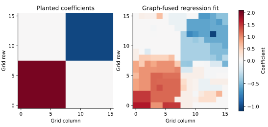
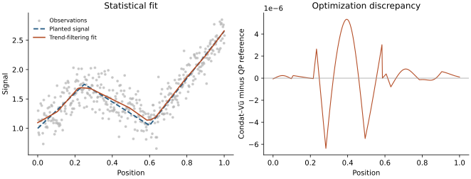

# [Choosing a splitting for a composite problem](@id composite_lessons)

An optimization algorithm is useful when it exposes operations that are easy
for a particular problem. Comparing two implementations of the same iteration
does not answer the more important question: could a different formulation
exploit more structure?

These notes develop two examples for

```math
\min_x F(x)=f(x)+g(x)+h(Dx).
```

The first is sparse regression with fusion over an irregular graph. It has two
simple penalties whose joint proximal operator is difficult. The second is
second-difference trend filtering. It fits the same template, but admits a
specialized ADMM splitting built from a direct first-difference TV prox.
They illustrate both the usefulness and the limitations of a general solver.

Read the examples in this order:

1. Formulate the statistical objective and identify the operations available.
2. Derive the primal–dual and ADMM updates.
3. Construct an accuracy certificate independent of either stopping rule.
4. Compare complete solves, including setup, and interpret the limitations.

The executable examples use only ProximalBase, ProximalSolvers and the standard
library. Their small reference algorithms are teaching code in
`examples/support/primal_dual_lessons.jl`, not additional public solvers. The
separate benchmark environment adds JuMP and HiGHS for independent QP checks.

## Why introduce a dual variable?

Suppose ``g(x)=\lambda_1\|x\|_1`` and ``h(z)=\lambda_2\|z\|_1``. Each has a
simple soft-thresholding proximal operator. Nevertheless, for a general ``D``,

```math
\operatorname{prox}_{t(g+h\circ D)}(v)
=\arg\min_x\left\{\tfrac12\|x-v\|^2
 +t\lambda_1\|x\|_1+t\lambda_2\|Dx\|_1\right\}
```

is itself a coupled optimization problem. Soft-thresholding ``Dv`` and then
mapping back is not generally its solution. Nor can we generally compose the
two proximal operators to get the proximal operator of the sum.

The conjugate identity gives

```math
h(Dx)=\max_{\|y\|_\infty\leq\lambda_2}\langle Dx,y\rangle.
```

Consequently, the saddle problem has a smooth gradient in ``x``, a separable
proximal operation for ``g``, and a box projection for ``y``. Condat–Vũ uses

```math
\begin{aligned}
x^{k+1}&=\operatorname{soft}_{\tau\lambda_1}
 \{x^k-\tau[\nabla f(x^k)+D^\top y^k]\},\\
y^{k+1}&=\operatorname{clip}_{[-\lambda_2,\lambda_2]}
 \{y^k+\sigma D(2x^{k+1}-x^k)\}.
\end{aligned}
```

For a global gradient bound ``L``, positive steps must satisfy
``\tau(L/2+\sigma\|D\|_2^2)<1``. The fixed-point conditions are

```math
0\in\nabla f(x)+\partial g(x)+D^\top y,\qquad
y\in\partial h(Dx).
```

For an edge with a positive difference, the second condition requires
``y_e=\lambda_2``; a negative difference requires ``y_e=-\lambda_2``; at a
zero difference any coordinate in the box is allowed. The edge duals enter
coefficient stationarity through ``D^\top y``. Feasibility of the box alone
does not guarantee optimality: both conditions must hold.

There is no joint proximal subproblem or matrix factorization. This separation
is the central motivation of [Condat's splitting method](https://lcondat.github.io/publis/Condat-optim-JOTA-2013.pdf).
The [Primal–dual splitting](@ref) guide explains step bounds, residuals, and the distinction
between fixed-step convergence results and the optional adaptation heuristics.

This argument requires an actual difficulty in the joint prox. For ordinary
chain-TV denoising, use the direct `TotalVariation1D` prox. For an arbitrary
smooth loss plus chain TV, that same prox can be used inside proximal gradient
or FISTA. A nonidentity design matrix alone does not make primal–dual splitting
the preferred method. `FusedLasso` also supplies the joint prox for coefficient
ℓ1 plus first-difference chain TV in ProximalBase.

## Example 1: sparse regression with fusion over an irregular graph

Let a vertex represent a coefficient, and let an edge join two coefficients
expected to have similar values. Choose an orientation for every edge and
let ``D`` be the incidence matrix: row ``(i,j)`` contains ``-1`` at ``i`` and
``+1`` at ``j``. The orientation has no effect on ``\|Dx\|_1``.

Consider

```math
F(x)=\tfrac12\|b-Xx\|^2+\tfrac\mu2\|x\|^2
       +\lambda_1\|x\|_1+\lambda_2\|Dx\|_1,\qquad \mu>0.
```

Coefficient sparsity and edge fusion have different meanings. A zero
coefficient removes a vertex's effect; a zero edge difference identifies equal
effects at two connected vertices. The ridge term stabilizes an underdetermined
design and makes the minimizer unique. It also supplies the strong-convexity
constant used below. Its inclusion is part of the estimator, not a numerical
change we may silently add to an existing model.

### Data and scaling

The reproducible example starts with a square grid and adds random nonlocal
edges. Cycles and shortcuts remove the chain structure. The sparse design has
``n=p/2`` observations and eight sampled entries per column, with repeated row
indices combined by the sparse constructor. A few rectangular coefficient
regions have distinct levels, and the observations include Gaussian noise.
The graph is supplied to the estimator; it is not estimated from these data.
Some shortcuts join different planted regions, so the graph prior is
deliberately imperfect.

We use an **unnormalized** least-squares loss, ``\mu=0.2``,
``\lambda_1=0.05`` and ``\lambda_2=0.2``. Replacing the loss by a sample mean
without changing the penalties would define a different problem. These values
illustrate optimization; they are not selected by cross-validation.



The display places coefficients at their original grid positions. The fitting
graph also has nonlocal edges, which are not drawn. Shrinkage and fusion alter
the planted levels; a correctly optimized estimator need not recover the true
coefficient field exactly.

The executable [graph-fusion example](examples/15_graph_fusion.md) constructs
the problem and checks two solutions. Its main call is represented by

```julia
f = Sum(LeastSquaresLoss(b, X), SqrNormL2(μ))
g, h = NormL1(λ1), NormL1(λ2)
L = opnorm(X, 1) * opnorm(X, Inf) + μ
normD = sqrt(opnorm(D, 1) * opnorm(D, Inf))
res = solve!(zeros(size(X, 2)), f, g, h, D,
             CondatVu(; L, normD), options; gap = relative_certificate)
```

Here `relative_certificate` is the callback derived below, and `options`
sets its target. The bounds are conservative but require neither a dense SVD
nor ``X^\top X``. For an incidence matrix,
``\|D\|_2^2\leq 2d_{\max}``, where ``d_{\max}`` is the maximum vertex degree.
Poor bounds can slow the method. Tightening a bound must preserve its validity;
a numerical norm estimate is not automatically a certified upper bound.

### A competing ADMM formulation

Introduce ``z=Cx`` with ``C=[I;D]`` and
``q(z)=\lambda_1\|z_1\|_1+\lambda_2\|z_2\|_1``. Scaled ADMM gives

```math
\begin{aligned}
[X^\top X+\mu I+\rho C^\top C]x^{k+1}
 &=X^\top b+\rho C^\top(z^k-u^k),\\
z^{k+1}&=\operatorname{prox}_{q/\rho}(Cx^{k+1}+u^k),\\
u^{k+1}&=u^k+Cx^{k+1}-z^{k+1}.
\end{aligned}
```

The proximal step is weighted soft thresholding. The system matrix is constant
within a fit, so its Cholesky factorization can be reused. Forming the normal
matrix and factoring it may be inexpensive on a small graph. On other graphs,
fill-in can make a sparse input yield a much less sparse factor. A factorization
can also be reused across penalty values if ``X``, ``D``, ``\mu`` and ``\rho``
remain fixed; the benchmark below measures fresh single fits.

Condat–Vũ instead applies ``X``, ``X^\top``, ``D`` and ``D^\top`` at every
ordinary iteration. The tradeoff is cheaper steps versus the stronger
subproblem solved by ADMM. Neither iteration count nor sparsity of the input
alone determines the winner.

This reference implements ADMM for a general linear constraint. The package's
`ADMMSolver` exposes an ``x=z`` split, so it cannot simply be called on this
objective to obtain these updates.

### An independent QP reference

JuMP models residual variables ``r=Xx-b`` and epigraph variables
``t\geq\pm x`` and ``v\geq\pm Dx``. The objective is

```math
\tfrac12\|r\|^2+\tfrac\mu2\|x\|^2
  +\lambda_1\mathbf1^\top t+\lambda_2\mathbf1^\top v.
```

HiGHS solves this convex QP independently of either splitting iteration.
Residual variables preserve the sparse design in the model instead of
explicitly expanding a potentially dense ``X^\top X``. The difference of the
two edge-constraint multipliers supplies the edge dual used by our certificate.

## A common certificate for both examples

An objective difference from a reference value is useful, but does not by
itself certify a solution. We can obtain a lower bound directly.

Suppose ``f`` is ``\mu``-strongly convex, ``g(x)=\lambda_1\|x\|_1`` and
``h(z)=\lambda_2\|z\|_1``. At any ``x`` and any
``\|y\|_\infty\leq\lambda_2``, define

```math
\begin{aligned}
m_x(z)&=f(x)+\langle\nabla f(x),z-x\rangle
                  +\tfrac\mu2\|z-x\|^2,\\
\ell(x,y)&=\min_z\{m_x(z)+g(z)+\langle D^\top y,z\rangle\}.
\end{aligned}
```

Strong convexity gives ``m_x(z)\leq f(z)``, while dual feasibility gives
``\langle y,Dz\rangle\leq h(Dz)``. Therefore

```math
\ell(x,y)\leq F^*\leq F(x),\qquad
0\leq F(x)-F^*\leq G(x,y):=F(x)-\ell(x,y).
```

The lower model has a closed-form minimizer:

```math
z_0=\operatorname{soft}_{\lambda_1/\mu}
 \left(x-\frac{\nabla f(x)+D^\top y}{\mu}\right).
```

Substituting ``z_0`` into the expression for ``\ell`` evaluates the bound using
one gradient, matrix products, and soft thresholding. No reference optimum,
inverse, or inner iteration is needed. For graph regression this lower model
can be conservative: ``G`` bounds suboptimality, but need not equal the exact
Fenchel gap. For trend filtering below, the quadratic lower model is exact,
so it is the usual primal–dual gap at a feasible edge dual.

All methods are evaluated at a feasible dual, clipping to the box when
necessary, and use the same normalization

```math
G_{\rm rel}=\frac{G}{\max\{1,|F(x)|,|\ell(x,y)|\}}.
```

The iterative algorithms check this certificate every 25 iterations and stop
at ``G_{\rm rel}\leq10^{-6}``. Clipping an ADMM multiplier constructs a valid
certificate; it does not assert that ADMM's raw multiplier is already optimal.
HiGHS uses its own tighter internal tolerances, and the same external
certificate is checked at its returned solution. Thus the comparison enforces
a common acceptance target, not identical numerical errors at termination.

Strong convexity also gives an interpretable coefficient bound:

```math
\|x-x^*\|_2\leq\sqrt{2G(x,y)/\mu}.
```

The examples check that the distance between two computed solutions is no
larger than the sum of their bounds. The QP checks also verify that objective
and coefficient discrepancies lie within the certified bounds. A relative
objective target does not imply the same relative accuracy in each coordinate,
and none of these optimization checks validates statistical inference.

## Example 2: second-difference trend filtering

For an equally spaced sequence, write ``B_p`` for its first-difference matrix
and ``D_2=B_{p-1}B_p``. We solve

```math
\min_x\ \tfrac12\|x-b\|^2+\lambda\|D_2x\|_1.
```

A zero second difference means a constant slope. The penalty therefore
encourages piecewise linear fits. We use a signal with two slope changes,
Gaussian noise, and ``\lambda=8``. The differences are taken on the **index
grid**. Rescaling to derivatives in physical time requires rescaling the
operator and interpreting the penalty accordingly; comparisons must solve
the same objective.

Condat–Vũ sets ``g=0``, ``h=\lambda\|\cdot\|_1`` and ``D=D_2``. Ordinary ADMM
instead splits ``z=D_2x``; its system matrix is ``I+\rho D_2^\top D_2``.
Here that matrix is banded, so a factorization is much less threatening than
for a general graph. This is already a meaningful alternative.

### Retain the first-difference structure inside the prox

A stronger alternative introduces ``\alpha=B_px`` and solves

```math
\min_{x,\alpha}\ \tfrac12\|x-b\|^2
       +\lambda\operatorname{TV}(\alpha)
\quad\text{subject to}\quad \alpha=B_px.
```

Its updates are

```math
\begin{aligned}
(I+\rho B_p^\top B_p)x^{k+1}
 &=b+\rho B_p^\top(\alpha^k-u^k),\\
\alpha^{k+1}
 &=\operatorname{prox}_{(\lambda/\rho)\operatorname{TV}}
       (B_px^{k+1}+u^k),\\
u^{k+1}&=u^k+B_px^{k+1}-\alpha^{k+1}.
\end{aligned}
```

The first system is tridiagonal. The second step uses ProximalBase's direct
`TotalVariation1D` prox. This is the specialized splitting developed by
[Ramdas and Tibshirani](https://arxiv.org/abs/1406.2082), rather than a new
algorithm introduced by this package. Our short reference uses ``\rho=\lambda``
and reuses a tridiagonal Cholesky factor.

To apply the common certificate, let ``v=\rho u``. The TV proximal step gives
``v=B_{p-1}^\top y`` for a feasible difference dual, up to numerical error.
With rows ``(-1,+1)``, this relation implies
``y_j=-\sum_{i\leq j}v_i``. The reference reconstructs these coordinates by
cumulative summation and clips them before evaluation. This sign is important:
the certificate uses ``+D_2^\top y`` in primal stationarity.

The executable [trend-filtering example](examples/16_trend_filtering.md) checks
all three solutions. A direct first-difference prox does not solve this
second-difference problem in one call, but it is precisely what makes a better
splitting possible. Specialized path algorithms and more elaborate
trend-filtering implementations are additional alternatives; these few
comparisons are not an exhaustive solver survey.



The left panel concerns statistical estimation; the right concerns numerical
optimization. The fit can differ visibly from the planted signal even while
the two optimization methods agree closely. The QP reference is itself a
floating-point numerical solution, not an exact symbolic optimum.

## Measured comparisons

The benchmark runs two graph sizes and two sequence lengths. It warms the
complete call paths, repeats each method three times, and reports the measured
run with median total time. Setup includes constructing/factoring ADMM systems
or building the QP model; solve time includes scheduled certificate checks for
the iterative methods. Data generation and compilation are excluded for all
methods. The native solve includes its state initialization. Certificate
evaluations after return, factor-size diagnostics, and result comparisons are
validation work outside the measured solve.

Ordinary ADMM is reported at ``\rho=1,10`` for graph regression and
``\rho=1,10,100`` for trend filtering. None is
claimed to be optimally tuned. Condat–Vũ uses the default bounded adaptation
and restarts with certified norm bounds. No method receives a warm-started
solution, and no path-level speedup is established.
Each iterative run has a 200,000-iteration and 15-second solve limit.
Runs that hit a limit are marked as unsuccessful at the common target;
their elapsed times must not be compared as times to convergence.

The retained results and interpretation follow in the [measurement record](composite_results.md).
The [benchmark directory](https://github.com/mlakolar/ProximalSolvers.jl/tree/master/benchmark/composite_lessons)
contains the independent QP model, raw CSV, source/environment record and
recreation commands. JuMP/HiGHS stay outside the runtime and documentation
dependencies.

## What to take to another problem

Choose Condat–Vũ when the individual gradient/proximal operations are easy,
the joint proximal operator is awkward, and matrix products are preferable
to solving a coupled subproblem. Graph fusion with a sparse design is a
natural example. This is a useful default candidate for a new formulation,
not a promise that it will beat ADMM or a QP solver.

Prefer a direct or specialized method when it exposes more useful structure.
For first-difference chain denoising, use the direct prox. For a smooth loss
with a cheap joint penalty prox, try proximal gradient/FISTA. For trend
filtering, compare a specialized splitting. For a problem with a reusable
cheap factorization, give ADMM a serious comparison.

Finally, distinguish the mathematical algorithm from this implementation.
The present examples exercise CPU dense vectors and sparse real matrices.
They do not demonstrate GPU execution, a general matrix-free operator API,
or sparse storage for all work arrays. The accuracy certificate here uses an
explicit positive strong-convexity constant; dropping ridge from an
underdetermined graph regression invalidates this particular certificate,
even though the convex problem may still be solvable by Condat–Vũ.

## Exercises

1. Remove the graph shortcuts. Which matrix products change, and how much
   does ADMM factor fill-in change? Keep the objective and accuracy target
   fixed when comparing implementations of the same instance.
2. Compare fresh fits with a sequence of penalty levels. Reuse ADMM's factor
   when its matrix is unchanged, and warm start both primal and dual iterates
   for Condat–Vũ. Report the entire path cost for both.
3. Decrease ``\mu`` in graph regression. Explain separately its effect on the
   estimator, the optimization conditioning, and the conservatism of the
   certificate. Why is simply setting ``\mu=0`` in the formula invalid?
4. Replace second differences by first differences. Compare a direct TV call,
   Condat–Vũ, and ADMM. Explain why the direct solution changes the appropriate
   baseline.
5. Tighten the common target from ``10^{-6}`` to ``10^{-8}``. Do the timing
   rankings persist? Check certificate validity and coefficient discrepancies,
   rather than relying only on solver status messages.

## Further reading

- L. Condat (2013). [A primal–dual splitting method for convex optimization
  involving Lipschitzian, proximable and linear composite terms](https://lcondat.github.io/publis/Condat-optim-JOTA-2013.pdf).
- A. Ramdas and R. J. Tibshirani (2016). [Fast and flexible ADMM algorithms
  for trend filtering](https://arxiv.org/abs/1406.2082).
- T. B. Arnold and R. J. Tibshirani (2016). [Efficient implementations of the
  generalized lasso dual path algorithm](https://arxiv.org/abs/1405.3222).
- Y.-X. Wang, J. Sharpnack, A. J. Smola and R. J. Tibshirani (2016).
  [Trend filtering on graphs](https://www.jmlr.org/papers/v17/15-147.html).
